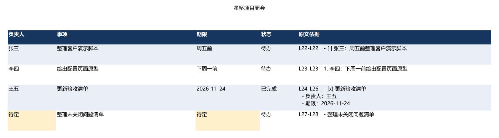

# Tencent Meeting Notes: from pasted notes to an action plan
Paste Yuanbao notes, Tencent Meeting minutes or Markdown to get structured minutes, a DOCX document and an XLSX action tracker.
Cross-platform and stateless: no meeting history, Tencent token or model API key.

[中文](README.md) · [Agent skill](SKILL.md) · [Sample input](examples/yuanbao-weekly.md)

## Tools

| Tool | Input | Output |
|---|---|---|
| `prepare_meeting_notes` | `text`, optional `title`, `meeting_date` | `minutes`, normalized `markdown`, `warnings` |
| `export_meeting_minutes` | The returned **minutes object** | DOCX minutes and XLSX tracker; `path`, `downloadUrl`, `bytes`, `sha256` for each file |
| `merge_action_items` | `meetings: [minutes, ...]`, optional `week_start`, `owner` | Weekly action plan grouped by owner and date, plus Markdown |

All tools publish input/output JSON Schema and return `structuredContent` with one short display message. The service uses the official Python SDK **mcp==2.3.0**, verified on PyPI on 2026-11-23 and pinned in the lock file. Its high-level API is `MCPServer`, the v2 successor to FastMCP, not the third-party `fastmcp` package. See the [official installation guide](https://github.com/modelcontextprotocol/python-sdk#installation) and [structured output documentation](https://py.sdk.modelcontextprotocol.io/servers/structured-output/).

## Actual output

All examples are synthetic and contain no real meeting data. These files were generated through a real MCP Client call, not reconstructed mockups.

Paste [examples/yuanbao-weekly.md](examples/yuanbao-weekly.md), whose action section includes mixed lists and nested fields:

```markdown
## 待办

- [ ] 张三：周五前整理客户演示脚本
1. 李四：下周一前给出配置页面原型
- [x] 更新验收清单
  - 负责人：王五
  - 期限：2026-11-24
- 整理未关闭问题清单
```

The result has a title, date, attendees, 3 topic summaries, 2 decisions, 4 actions and 1 unresolved question. Missing owners/deadlines are `待定` (undetermined), not invented.

[Minutes](docs/minutes.md) · [Structured JSON](docs/prepared.json) · [Merged weekly plan](docs/weekly-actions.md) · [DOCX](docs/meeting-minutes.docx) · [XLSX](docs/action-items.xlsx)

This is a page image exported from the actual XLSX using Microsoft Excel's PDF renderer:



## Install and run

Python **3.10+**, with 3.12 recommended. The cloud service runs on Linux, macOS and Windows without desktop capture dependencies.

```bash
python -m venv .venv
source .venv/bin/activate
# Windows PowerShell: .venv\Scripts\Activate.ps1
python -m pip install -r requirements.lock
python -m pip install --no-deps .
python scripts/generate_examples.py
```

The last command uses a real stdio MCP Client to prepare two meetings, merge actions and export Office files into `output/example/`. The lock file includes test dependencies. `pip install .` also installs the service. Launch with `meeting-notes-mcp` or `python -m meeting_notes.server`.

### stdio

Use absolute paths for the interpreter and artifact directory. stdout is reserved for MCP messages.

```json
{
  "mcpServers": {
    "tencent-meeting-notes": {
      "command": "/absolute/path/.venv/bin/python",
      "args": ["-m", "meeting_notes.server"],
      "env": {
        "MCP_TRANSPORT": "stdio",
        "OUTPUT_DIR": "/absolute/path/meeting-output"
      }
    }
  }
}
```

For Windows, a command path can be `D:\\tools\\meeting-notes\\.venv\\Scripts\\python.exe`.

### Stateless Streamable HTTP

Linux / macOS:

```bash
MCP_TRANSPORT=http PORT=8000 OUTPUT_DIR=./output PUBLIC_BASE_URL=http://localhost:8000 meeting-notes-mcp
```

Windows PowerShell:

```powershell
$env:MCP_TRANSPORT="http"
$env:PORT="8000"
$env:OUTPUT_DIR="./output"
$env:PUBLIC_BASE_URL="http://localhost:8000"
meeting-notes-mcp
```

Client configuration:

```json
{"mcpServers":{"tencent-meeting-notes":{"url":"http://localhost:8000/mcp"}}}
```

`GET /health` checks readiness. `GET /files/<random-id>/<filename>` downloads an artifact. Each export gets a new random directory. `downloadUrl` is null unless `PUBLIC_BASE_URL` is configured; local paths are always returned.

### Docker and Kuku AI deployment

```bash
docker build -t tencent-meeting-notes:3 .
docker run --rm -p 8000:8000 -e PUBLIC_BASE_URL=http://localhost:8000 tencent-meeting-notes:3
```

The production gateway must provide HTTPS, authentication and request limits for **both** `/mcp` and `/files/`. The container uses a non-root user. Mount a writable volume at `/app/output` if artifacts must persist.

| Variable | Default | Purpose |
|---|---|---|
| `MCP_TRANSPORT` | `stdio` | `stdio` or `http` |
| `HOST` | `127.0.0.1` | HTTP binding; `0.0.0.0` in Docker |
| `PORT` | `8000` | HTTP port |
| `OUTPUT_DIR` | `./output` | Artifact directory; `/app/output` in Docker |
| `PUBLIC_BASE_URL` | unset | Public base URL, including optional proxy prefix; enables download URLs and allows its Host |
| `ALLOWED_HOSTS` | localhost and public base Host | Additional comma-separated HTTP Host values, optionally with port |

The platform agent reads the user-selected attachment as UTF-8 text before invoking preparation. Tools accept neither arbitrary file paths nor URLs, Tencent credentials or user identity parameters. They make no external network or model calls and have no database or history queries. Only export writes Office artifacts. The platform owns artifact retention and cleanup; no delete tool is exposed.

## Parsing and merge rules

- Supports Yuanbao overview/summary/actions, explicit decisions and unresolved questions, plus legacy post-meeting summaries and real-time notes. Handles ordered, unordered, checkbox and nested lists, and action Markdown tables.
- Extracts decisions/actions only from labelled sections. Unclassified text remains in `other_notes`. Each record includes original line references (`source_ref`), quotations (`source_text`) and its section path.
- Owner prefixes such as `张三：周五前整理脚本` are assignment syntax, not general topic labels. Explicit `负责人：`, `期限：`, `状态：` fields are supported. Unspecified owners/deadlines become `待定`. Legacy meeting/room metadata is omitted from deliverables. Owners are not automatically treated as attendees.
- A minutes object has `title`, `meeting_date`, `participants`, `topics`, `decisions`, `actions`, `unresolved`, `other_notes`.
- Original relative deadline wording is preserved. During merge, today/tomorrow/the day after and weekday expressions resolve only against an explicit meeting date. An unqualified Friday means Friday in the meeting's week, not an automatically advanced future Friday.
- `week_start` must be a Monday. It filters known deadlines to that inclusive seven-day window while retaining undetermined dates separately. `owner` is an exact match. Only identical whole-meeting inputs are deduplicated; identical tasks in distinct meetings remain distinct.
- Raw input is limited to 256 KiB, a structured meeting to 2 MiB, and each XLSX cell to 32767 characters. Oversized input is rejected, not truncated. Formula-like note text is exported as literal text.

Business errors return `isError=true` and `code`, `message`, `next_action`, `retryable`, including `EMPTY_INPUT`, `INPUT_TOO_LARGE`, `INVALID_DATE`, `INVALID_TEXT`, `CELL_TOO_LARGE`, `EXPORT_FAILED`. Invalid tool schemas are rejected by the SDK.

## Tests

```bash
python -m pytest -q
```

Tests launch actual stdio and HTTP processes, use the official MCP Client to list and call all three tools, reopen DOCX/XLSX files, and verify downloads, SHA-256, mixed lists, source evidence, missing fields, date grouping and repeated input. They need no Tencent account, model key or Office installation. Excel is used only to produce the documentation image.

## Local mode (Windows)

The original `scripts/wemeet_notes.py`, `wemeet_dump.ps1` and `wemeet_ui_grab.py` remain separate from the cloud tool list.

```powershell
python scripts\wemeet_notes.py --list
python scripts\wemeet_notes.py --meeting <meeting_id>
```

Local capture requires a running Tencent Meeting client and matching process permissions. UI fallback additionally requires a logged-in desktop, optional capture dependencies and user approval. See the [Windows local guide (Chinese)](docs/windows-local.md) for all commands and offline dump parsing.

## Limitations

- These tools organize existing notes; they neither recover omitted audio nor semantically summarize arbitrary prose for the agent.
- Ambiguous dates such as month-end or month/day without a year retain their wording and remain undetermined in the weekly plan.
- No real personal meetings were captured in this upgrade; client releases can change local capture behavior.
- Docker requires a running engine; cross-platform validation for this upgrade uses headless WSL Linux.

## License

MIT, preserving the original repository license.
