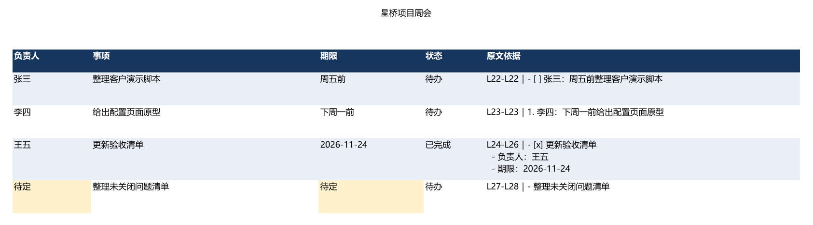

# 腾讯会议纪要：从笔记到行动表
粘贴元宝笔记、腾讯会议纪要文本或 Markdown，得到规范纪要、DOCX 和 XLSX 待办表。
跨平台、无状态，不保存会议历史；无需腾讯 Token 或模型 Key。

[English](README.en.md) · [Agent Skill](SKILL.md) · [完整输入样例](examples/yuanbao-weekly.md)

## 一次交付什么

| 工具 | 输入 | 返回 |
|---|---|---|
| `prepare_meeting_notes` | `text`，可选 `title`、`meeting_date` | `minutes` 结构化结果、规范 `markdown`、`warnings` |
| `export_meeting_minutes` | 上一步的 `minutes` 对象 | DOCX 公司会议纪要、XLSX 待办跟踪表；每个文件有 `path`、`downloadUrl`、`bytes`、`sha256` |
| `merge_action_items` | 当前对话的 `meetings: [minutes, ...]`，可选 `week_start`、`owner` | 按负责人和日期分组的周行动表、Markdown |

所有工具声明输入和输出 JSON Schema，成功响应包含 `structuredContent` 和一句摘要。MCP Python SDK **2.3.0** 是 2026-11-23 在 PyPI 核实的稳定版，已锁定；使用官方高层 `MCPServer`，即旧 FastMCP 的 v2 API，非第三方 `fastmcp` 包。参见 [官方安装说明](https://github.com/modelcontextprotocol/python-sdk#installation) 和 [结构化输出文档](https://py.sdk.modelcontextprotocol.io/servers/structured-output/)。

## 真实运行样例

仓库样例均为合成脱敏内容。以下结果由真实 MCP Client 调用生成。

粘贴 [examples/yuanbao-weekly.md](examples/yuanbao-weekly.md) 中的笔记，例如其中的待办段：

```markdown
## 待办

- [ ] 张三：周五前整理客户演示脚本
1. 李四：下周一前给出配置页面原型
- [x] 更新验收清单
  - 负责人：王五
  - 期限：2026-11-24
- 整理未关闭问题清单
```

整理得到标题、日期、参会人、3 条议题小结、2 条决策、4 条待办和 1 条未决问题。[完整纪要](docs/minutes.md) · [结构化 JSON](docs/prepared.json) · [跨会周行动表](docs/weekly-actions.md)

| 负责人 | 事项 | 期限 | 状态 |
|---|---|---|---|
| 张三 | 整理客户演示脚本 | 周五前 | 待办 |
| 李四 | 给出配置页面原型 | 下周一前 | 待办 |
| 王五 | 更新验收清单 | 2026-11-24 | 已完成 |
| 待定 | 整理未关闭问题清单 | 待定 | 待办 |

[下载示例 DOCX](docs/meeting-minutes.docx) · [下载示例 XLSX](docs/action-items.xlsx)

下图是上述 XLSX 在 Microsoft Excel 中导出 PDF 后的页面截图，直接来自实际生成文件。



## 五分钟启动

Python **3.10+**，建议 3.12。Linux、macOS、Windows 使用同一云端服务，不安装桌面采集依赖。

```bash
python -m venv .venv
# Linux / macOS
source .venv/bin/activate
# Windows PowerShell 改用：.venv\Scripts\Activate.ps1
python -m pip install -r requirements.lock
python -m pip install --no-deps .
python scripts/generate_examples.py
```

最后一条命令通过真实 stdio MCP Client 完成整理、合并、导出，成品写到 `output/example/`。依赖锁包含测试依赖；用 `pip install .` 也可安装服务。入口为 `meeting-notes-mcp` 或 `python -m meeting_notes.server`。

### stdio 接入

将解释器和输出目录改为部署机的绝对路径。stdio 的 stdout 只输出 MCP 协议。

```json
{
  "mcpServers": {
    "tencent-meeting-notes": {
      "command": "/absolute/path/.venv/bin/python",
      "args": ["-m", "meeting_notes.server"],
      "env": {
        "MCP_TRANSPORT": "stdio",
        "OUTPUT_DIR": "/absolute/path/meeting-output"
      }
    }
  }
}
```

Windows 的 `command` 示例：`D:\\tools\\meeting-notes\\.venv\\Scripts\\python.exe`。

### 无状态 Streamable HTTP

Linux / macOS：

```bash
MCP_TRANSPORT=http PORT=8000 OUTPUT_DIR=./output PUBLIC_BASE_URL=http://localhost:8000 meeting-notes-mcp
```

Windows PowerShell：

```powershell
$env:MCP_TRANSPORT="http"
$env:PORT="8000"
$env:OUTPUT_DIR="./output"
$env:PUBLIC_BASE_URL="http://localhost:8000"
meeting-notes-mcp
```

连接配置：

```json
{"mcpServers":{"tencent-meeting-notes":{"url":"http://localhost:8000/mcp"}}}
```

健康检查 `GET /health`；产物下载 `GET /files/<随机id>/<文件名>`。每次导出使用独立随机目录，不覆盖前次文件。未配置 `PUBLIC_BASE_URL` 时 `downloadUrl` 为 null，仍返回本机路径。

### 容器与库库平台封装

```bash
docker build -t tencent-meeting-notes:3 .
docker run --rm -p 8000:8000 -e PUBLIC_BASE_URL=http://localhost:8000 tencent-meeting-notes:3
```

生产环境由网关提供 HTTPS、认证和请求限额，同时保护 `/mcp` 与 `/files/`。容器以非 root 用户运行；需要保留文件时挂载可写卷到 `/app/output`。

| 环境变量 | 默认 | 用途 |
|---|---|---|
| `MCP_TRANSPORT` | `stdio` | `stdio` 或 `http` |
| `HOST` | `127.0.0.1` | HTTP 监听地址；容器默认 `0.0.0.0` |
| `PORT` | `8000` | HTTP 端口 |
| `OUTPUT_DIR` | `./output` | 导出目录；容器为 `/app/output` |
| `PUBLIC_BASE_URL` | 未设置 | 对外基础 URL；支持代理路径前缀，返回下载链接并允许对应 Host |
| `ALLOWED_HOSTS` | 本机及 PUBLIC_BASE_URL | 额外允许的 HTTP Host，逗号分隔，可含端口 |

平台 agent 将用户选择的附件读成 UTF-8 文本后传给整理工具。工具不接受任意路径、URL、会议账号或宿主身份。无外部网络调用、模型调用、数据库或跨会话查询。只有导出工具写 Office 产物；平台负责输出卷的保留期限和到期清理，不提供删除工具。

## 解析与合并规则

- 识别元宝概览、议题小结、决策、待办和未决问题，以及旧脚本的会后总结/实时纪要章节。支持有序、无序、勾选、嵌套列表和待办 Markdown 表格。
- 只从明确决策/待办栏目抽取。未分类段落保留在 `other_notes`，不做语义扩写。每条记录附 `source_ref` 原文行号、`source_text` 原句及栏目路径。
- 支持“张三：周五前整理脚本”的负责人前缀，以及 `负责人：`、`期限：`、`状态：` 字段；负责人前缀用于派工，不用于一般主题标签。未写负责人或期限统一为“待定”。会议号等旧脚本元数据不进入交付稿。
- `minutes` 包含 `title`、`meeting_date`、`participants`、`topics`、`decisions`、`actions`、`unresolved`、`other_notes`。不从待办负责人反推参会人。
- 相对期限原样保留。合并时，仅以明确会议日期计算今天、明天、后天、周一至周日、下周和下下周；无前缀的“周五”指会议所在周周五，不自动移到下一周。
- `week_start` 必须是周一，按确定的待办期限筛选该周，日期待定项仍保留。`owner` 精确匹配。不同会议中的同文待办保留；完全相同的整场重复输入只计一次，不猜测任务已完成或被撤销。
- 原文上限 256 KiB；单场结构化导出上限 2 MiB；XLSX 单元格上限 32767 字符。超限拒绝，不截断。公式形式的笔记写为纯文本。

工具业务错误返回 `isError=true`，附 `code`、`message`、`next_action`、`retryable`，例如 `EMPTY_INPUT`、`INPUT_TOO_LARGE`、`INVALID_DATE`、`INVALID_TEXT`、`CELL_TOO_LARGE`、`EXPORT_FAILED`。不符合 Schema 的参数由 SDK 校验并返回工具错误。

## 实测

```bash
python -m pytest -q
```

测试实际启动 stdio 和 HTTP 子进程，用官方 MCP Client 列出工具并调用三个核心工具，读回 DOCX/XLSX，核对下载字节、SHA-256、混合列表、原文依据、缺失字段、跨会日期与重复输入。不需要腾讯账号、模型 Key 或 Office。Excel 仅用于制作上面的真实页面截图。

## 本机模式（Windows）

原有 `scripts/wemeet_notes.py`、`wemeet_dump.ps1`、`wemeet_ui_grab.py` 保留，不注册为云端 MCP 工具。

```powershell
python scripts\wemeet_notes.py --list
python scripts\wemeet_notes.py --meeting <meeting_id>
```

本机采集要求腾讯会议客户端和相应进程权限；UI 兜底另需桌面、采集依赖与用户授权。完整命令、离线 dump 解析和版本限制见 [Windows 本机指南](docs/windows-local.md)。

## 局限

- 工具整理已有笔记，不从录音恢复遗漏内容，也不替 agent 对自由散文做语义总结。
- 月底、无年份的月日等含糊期限保留原话，周表归入日期待定。
- 本机脚本未在本次操作用户的真实会议，客户端升级可能改变采集效果。
- Docker 镜像需部署方有运行中的引擎；本次跨平台验证使用无桌面的 WSL Linux 环境。

## 许可证

MIT，沿用仓库原许可证。
